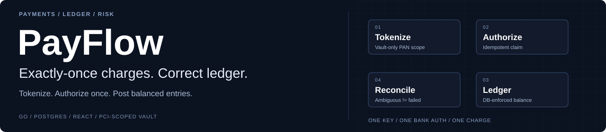
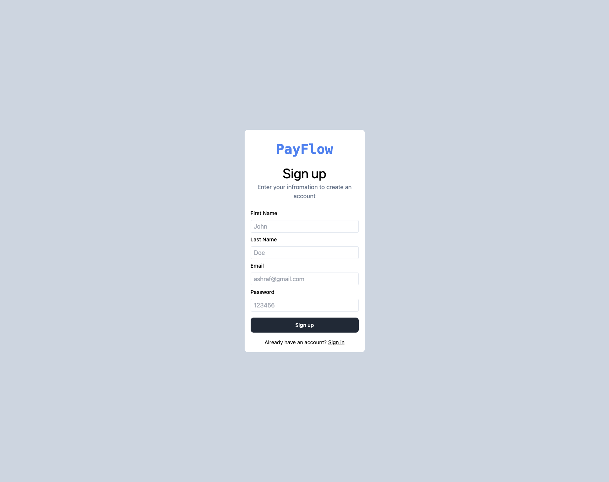
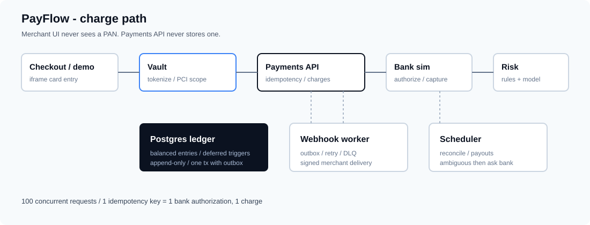

<p align="center"></p>

**Try the merchant UI:** [Open PayFlow](https://payflow.vercel.app/) · [Architecture](docs/ARCHITECTURE.md) · [Build log](docs/BUILD_LOG.md) · [Fraud model card](backend/ml/MODEL_CARD.md)

<p align="center">Go · Postgres · Redis · React · Docker Compose</p>

# PayFlow

**Exactly-once charges. Correct ledger.** A payment gateway where concurrent retries share one idempotency key, one bank authorization, and one balanced ledger write.

[**Open the dashboard ↗**](https://payflow.vercel.app/) · [Transaction flow](docs/PAYMENT_TRANSACTION_FLOW.md) · [System design](docs/payment-gateway-system-design_updated.md) · [Merchant example](backend/examples/merchant-server/README.md)

## The business problem

Accept a charge that may be retried a hundred times after a lost response — without double-authorizing the bank or posting an unbalanced ledger entry.

## See the workbench



Merchant-facing React dashboard for signup, charges, refunds, and activity. The full Go stack (payments API, vault, bank simulator, webhooks, fraud scoring) runs locally with Docker Compose; the public URL hosts the dashboard UI.

```
100 concurrent requests · 1 idempotency key → 1 bank authorization, 1 charge
```

## Architecture and authority



Checkout collects card data only inside the vault iframe. Payments API accepts opaque tokens, claims work with `INSERT … ON CONFLICT`, and commits the charge, ledger legs, and outbox row in one Postgres transaction. Risk rules run first; the fraud model can raise a verdict but never clear a hard block.


| Component | Owned responsibility |
| --- | --- |
| Vault | Only process that ever sees a PAN; tokens + last4/BIN everywhere else |
| Payments API | Idempotent charges, refunds, disputes, merchant read APIs |
| Ledger | Debits = credits enforced in Go, deferred DB triggers, and reconciliation |
| Risk / ML | Explainable rules first; XGBoost second; circuit-breaker fail-open to rules |
| Webhooks / scheduler | Outbox delivery with retry/DLQ; hourly reconcile; daily payouts |
| Dashboard / demo | React merchant UI and checkout demo for the iframe boundary |

**Not a licensed money transmitter.** The acquiring bank is a deterministic simulator. APIs and algorithms are built for real; institutional contracts (sponsor bank, KYC vendor, PCI QSA) are stubbed and documented.

## Repository layout

```text
payflow/
├── backend/
│   ├── cmd/                 payments-api, vault, bank-simulator, webhook-worker, scheduler
│   ├── internal/            money, ledger, idempotency, payments, vault, risk, reconcile
│   ├── migrations/          numbered SQL applied in order
│   ├── ml/                  fraud training, features, serving
│   ├── examples/            merchant-server integration sample
│   └── test/                load scripts (k6)
├── frontend/
│   ├── dashboard/           React + TypeScript merchant UI
│   └── demo/                checkout page (iframe boundary)
├── docs/
│   ├── ARCHITECTURE.md
│   ├── BUILD_LOG.md
│   └── assets/              branding, diagrams, demos
├── deploy/                  Kubernetes manifests
├── docker-compose.yml
└── Makefile
```

## Design decisions worth defending

1. **Postgres is the lock, not Redis** — `UNIQUE (merchant_id, idempotency_key)` with `ON CONFLICT DO NOTHING`. Claim, ledger, and outbox share one `pgx.Tx`.
2. **The ledger is enforced by the database** — Go check, deferred constraint trigger, and reconciliation. Append-only: no `UPDATE`/`DELETE` on entries.
3. **Ambiguous is not failed** — processor timeouts mark `requires_reconciliation`; no blind retry that could double-pay.
4. **A raw card number exists in exactly one service** — vault origin iframe + type system + Luhn scan on the charge API.

## Run locally

```sh
git clone https://github.com/Akhilesh-Vangala/payflow.git
cd payflow
make up                    # full local stack
make seed                  # prints an sk_test_... key (shown once)
make dashboard             # merchant UI on :5173
make test                  # unit + integration (Docker / testcontainers)
```

Ports: payments `8080`, vault `8081`, fraud scoring `8000`, bank simulator `8090`, Mailhog `8025`, dashboard `5173`.

```sh
TOKEN=$(curl -s -X POST localhost:8081/vault/tokenize \
  -H 'Content-Type: application/json' \
  -d '{"number":"4242424242424242","exp_month":12,"exp_year":2030}' \
  | python -c 'import sys,json;print(json.load(sys.stdin)["token"])')

curl -X POST localhost:8080/v1/charges \
  -H "Authorization: Bearer $PAYFLOW_KEY" \
  -H "Idempotency-Key: $(uuidgen)" \
  -H 'Content-Type: application/json' \
  -d "{\"amount\":4500,\"currency\":\"USD\",\"payment_token\":\"$TOKEN\"}"
```

Same `Idempotency-Key` twice → same charge body, no second authorization.

## Engineering evidence

| Check | Asserts |
| --- | --- |
| 100 concurrent, one key | 1 bank authorization |
| 10 concurrent refunds of 2000 on a 10000 charge | exactly 5 succeed |
| 20 concurrent chargeback redeliveries | funds reversed once |
| 30 concurrent detokenizations of a single-use token | exactly 1 succeeds |
| 50 concurrent ledger writes to one account | no lost updates |

```sh
make test-idempotency
make test-race
k6 run -e API_KEY=sk_test_... backend/test/load/idempotency.js
```

Fraud stack: 17 rules (~422ns) then IEEE-CIS XGBoost. Test PR-AUC and failure modes are documented in [`backend/ml/MODEL_CARD.md`](backend/ml/MODEL_CARD.md).

## Operating limits

| | |
| --- | --- |
| Real money movement | Not supported — bank is a simulator |
| Sponsor bank / money transmitter licence | Out of scope |
| KYC / sanctions / PCI QSA | Stubbed or vendor-shaped; not claimed |
| Public dashboard | UI demo; full gateway stack is local Compose |

## Documentation

| Doc | Contents |
| --- | --- |
| [`docs/ARCHITECTURE.md`](docs/ARCHITECTURE.md) | Services, tables, full charge flow |
| [`docs/BUILD_LOG.md`](docs/BUILD_LOG.md) | Build order and bugs paid for |
| [`docs/PAYMENT_TRANSACTION_FLOW.md`](docs/PAYMENT_TRANSACTION_FLOW.md) | End-to-end payment path |
| [`backend/ml/MODEL_CARD.md`](backend/ml/MODEL_CARD.md) | Fraud model card |
| [`backend/examples/merchant-server/`](backend/examples/merchant-server/README.md) | Merchant integration sample |

## Contributors

- [Sai Akhilesh Vangala](https://github.com/Akhilesh-Vangala)

See [CONTRIBUTORS.md](CONTRIBUTORS.md).

## License

MIT — Copyright (c) 2026 Sai Akhilesh Vangala
